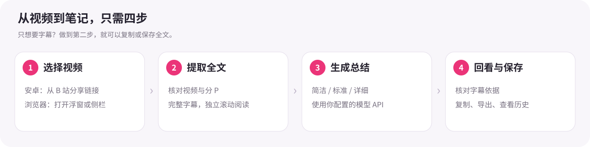
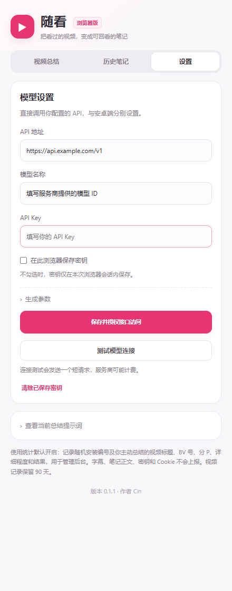
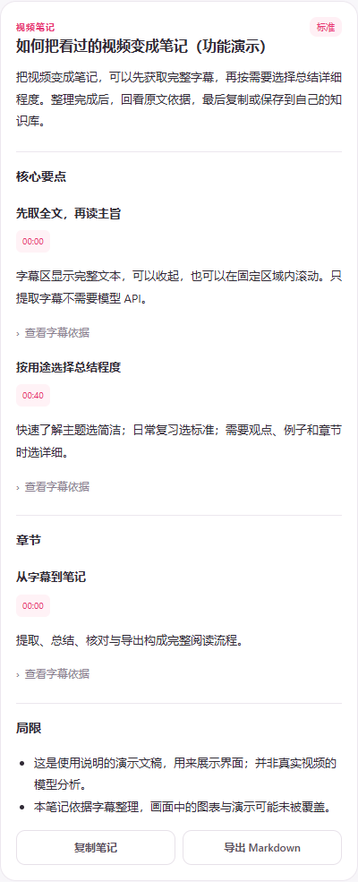

# 随看 SuiKan

**把看过的 B 站视频，变成可回看的笔记。**

随看支持安卓手机和桌面浏览器：提取完整字幕，按需要生成简洁、标准或详细总结，再结合字幕依据回看、复制和保存。作者 **Cin**。

[下载安卓 0.1.17](https://github.com/siacin/suikan/releases/download/v0.1.17/SuiKan-0.1.17-cloudbase.apk) · [下载浏览器扩展 0.1.1](https://github.com/siacin/suikan/releases/download/v0.1.17/SuiKan-Browser-0.1.1.zip) · [全部版本与校验文件](https://github.com/siacin/suikan/releases) · [更新记录](CHANGELOG.md) · [问题反馈](https://github.com/siacin/suikan/issues)

> 当前发行版默认启用使用统计，包括你主动总结的视频标题、编号和任务结果。字幕、笔记正文、模型密钥及 B 站 Cookie 不向统计后台上传。具体范围见下方[数据与隐私](#数据与隐私)。



**快速导航：** [下载与安装](#下载与安装) · [安卓使用](#安卓使用) · [浏览器使用](#浏览器使用) · [模型配置](#模型配置) · [字幕和笔记](#字幕和笔记) · [总结详细程度](#总结详细程度) · [常见问题](#常见问题)

## 下载与安装

| 你想在哪里用 | 下载文件 | 安装方法 |
|---|---|---|
| Android 8.0 及以上手机 | `SuiKan-0.1.17-cloudbase.apk` | 下载 APK 后安装；已有随看时直接覆盖更新 |
| 桌面 Microsoft Edge / Google Chrome | `SuiKan-Browser-0.1.1.zip` | 解压到固定文件夹，在扩展管理页以开发者模式加载 |
| 查看或自行修改源码 | `SuiKan-0.1.17-source.zip`，或直接克隆本仓库 | 安卓在 `app/`，浏览器在 `browser-extension/`，后台在 `statistics/` |

请到 [Releases 发布页](https://github.com/siacin/suikan/releases/tag/v0.1.17) 的 **Assets** 下载安装文件。GitHub 自动生成的 `Source code` 是源码压缩包，不能直接作为 APK 安装。

- **安卓更新：** 发布包沿用原签名。不要先卸载，以保留设置、助手内的 B 站登录、笔记和安装编号。自行构建的不同签名包可能无法覆盖官方发行包。
- **扩展更新：** 用新版文件覆盖原扩展文件夹，再在扩展管理页点“重新加载”。保留原文件夹路径，不要先删除扩展；重要笔记可提前导出备份。
- 扩展目前通过 GitHub 分发，**尚未上架微软或 Chrome 扩展商店**。本仓库旧地址 `siacin/suikan-android` 会跳转到 `siacin/suikan`。

## 安卓使用

### 第一步：把视频分享给随看

1. 在 B 站 APP 打开目标视频，点击 **分享**。
2. 在分享目标中找到 **随看**；未显示时，可从“更多 / 其他应用”中查找。
3. 随看打开后，确认输入框中的视频链接。也可以先复制链接，再打开随看点击 **粘贴链接**。

支持 B 站视频链接、`b23.tv` 短链和 BV 号；分享文字中带标题也可以使用。带 `p=2` 等参数的链接只处理对应的一 P，当前不自动合并多 P。

```text
B 站打开目标视频 → 分享 / 复制链接 → 随看 → 确认视频链接
                                        ├─ 只提取字幕 → 复制 / 保存文件
                                        └─ 选择总结程度 → 总结整段视频 → 查看笔记
```

### 第二步：只要文字，直接提取字幕

点击 **只提取字幕**，不需要模型地址或 API Key。提取完成后会显示来源核对信息和完整字幕：

- 字幕全文直接显示，正文区域固定高度，内部可以滚动，支持收起 / 展开。
- 点击复制或保存，可选择纯文字 TXT、带时间 TXT、SRT；SRT 需要文稿含有有效时间轴。
- “保存”会打开系统文件选择器，选择文件夹和名称即可，无需广泛存储权限。
- 视频没有可获取字幕时，可以点击 **导入字幕**，选择 TXT / SRT / VTT 或粘贴文稿。导入文稿会标注为未核验，不冒充当前视频字幕。

### 第三步：配置模型，再总结

首次总结前，打开底部 **设置**，填写自己的模型接口，按[模型配置](#模型配置)完成测试。返回 **视频总结**，选择简洁 / 标准 / 详细，点击 **总结整段视频**。

任务执行时可查看等待阶段与接收进度，也可以主动停止。完整结果通过校验后才保存；失败或取消不会把残缺回答保存为成功笔记，也不会覆盖已有完整笔记。

如果获取字幕时提示登录，请在随看设置中打开 **官方网页登录**，在助手内登录 B 站。B 站 APP 的登录不会自动变成助手内的登录。

### 悬浮入口怎么用

首页点击 **开启悬浮按钮**，按系统提示授予“显示在其他应用上层”。之后可以回到 B 站，点击悬浮按钮打开随看面板。

**安卓悬浮入口使用最近分享给随看的链接，不会自动识别 B 站当前播放的视频。** 换视频或分 P 后请重新分享。无需无障碍、通知访问或屏幕捕获授权；只使用分享流程时，也不需要开启悬浮权限。

## 浏览器使用

### 第一步：加载扩展

1. 解压 `SuiKan-Browser-0.1.1.zip`，保留解压后的文件夹。
2. Edge 打开 `edge://extensions`；Chrome 打开 `chrome://extensions`。
3. 开启 **开发者模式**，点击 **加载解压缩的扩展 / 加载已解压的扩展程序**。
4. 选择直接包含 `manifest.json` 的 **suikan-browser** 文件夹。若克隆本仓库，选择 **browser-extension** 文件夹。
5. 将随看固定到浏览器工具栏，便于随时打开侧栏。

### 第二步：在视频旁打开随看

在同一个浏览器登录 B 站，打开视频并刷新页面：

- 点击页面右下角 **随看**，打开可拖动、可收起的网页浮窗。
- 点击 **侧栏** 或工具栏扩展图标，在浏览器右侧打开面板。
- 点击 **只提取字幕**，无需配置模型；需要总结时先完成设置，再选择程度并点击 **总结整段视频**。
- 当前视频从活动标签页读取；也可以手动粘贴链接或 BV 号。切换视频会停止旧任务并清理旧结果，避免混用视频。


*图：当前扩展的实际界面。播放页面、字幕和笔记使用明确标注的功能演示内容，并非真实视频的模型测试。安卓部分的上图为操作流程示意。*

浮窗收起后保留面板；关闭或刷新页面、关闭面板可能中断模型请求。长任务期间请保留对应页面。

## 模型配置

安卓和浏览器分别保存配置，不自动同步。随看直接请求你配置的模型服务，不内置共享 API Key；服务商可能按调用计费。

<table>
<tr><td width="43%" valign="top">

</td><td valign="top">
<p><strong>① API 地址</strong><br>填写服务商提供的 OpenAI 兼容地址，例如 <code>https://api.example.com/v1</code>。这是格式示例，需要替换成自己的真实地址。</p>
<p><strong>② 模型名称</strong><br>填写服务商文档或控制台里的精确模型 ID，不能仅写展示昵称。</p>
<p><strong>③ API Key</strong><br>填写自己的密钥。不要将真实密钥发到 GitHub Issue、截图或公开代码中。</p>
<p><strong>④ 保存与测试</strong><br>浏览器点击“保存并授权该站访问”，允许访问填写的接口域名，再测试模型连接。安卓在设置中保存并测试。</p>
<p><strong>⑤ 生成参数</strong><br>输出额度为 0 时不主动设置输出上限；仍受模型和服务商限制。需要时在高级参数里调整思考模式。</p>
<p>截图中的接口和模型名称是占位示例，不是可用的免费服务。</p>
</td></tr>
</table>

浏览器默认只在当前浏览器会话保存密钥，勾选“在此浏览器保存密钥”后才会长期保存在本机扩展存储。安卓使用 Android Keystore 加密保存密钥。短连接测试成功只表示基本接口可用，不保证长视频请求一定成功。

## 字幕和笔记

| 想做什么 | 在哪里操作 |
|---|---|
| 阅读全文字幕 | 字幕卡片内独立滚动；需要时收起 / 展开 |
| 复制或另存字幕 | 选择格式，再点复制 / 保存；安卓通过系统文件选择器另存 |
| 查看总结 | 成功后显示概述、核心要点，以及内容支持的章节和方法 |
| 核对结论 | 点击 **查看字幕依据**；按时间位置回看原文或原视频 |
| 保留到自己的知识库 | **复制笔记** 或 **导出 Markdown** |
| 复习以前的内容 | 打开 **历史笔记**，查看、导出或删除 |



*图：浏览器版的演示笔记，使用说明文稿生成的示例响应；不是对某个真实视频的效果承诺。*

笔记保存在各自设备里，不是云端笔记同步。浏览器保留最近 30 篇笔记；卸载、清除应用/扩展数据会删除本机内容，重要笔记请及时导出。

## 总结详细程度

| 程度 | 更适合 | 正文参考长度 |
|---|---|---|
| 简洁 | 快速了解主旨、结论和必要条件 | 约 300–600 字 |
| 标准 | 日常复习、整理关键理由和可用方法 | 约 800–1500 字 |
| 详细 | 系统梳理观点、例子、推理和章节 | 浏览器约 2500–4500 字；安卓按材料分段详解 |

参考长度不是硬性字数限制，实际取决于材料与模型。

- **安卓：** 简洁和标准一次发送全部字幕，不因超限自动分批；详细模式按段整理后合成，通常调用更多、用时更长。
- **浏览器：** 三个档位都一次发送全部字幕，不自动分批。
- 网络中断最多有限重试；一次整段重试仍可能产生额外模型费用。输入或输出超限会明确失败，不假装完成。
- 不同程度分别保存笔记。安卓再次总结可能直接读取已有完整缓存，想重新生成时使用重新总结入口。

## 视频来源怎么核对

在线提取使用 B 站返回的字幕文本，**获取字幕不由 AI 编造**。程序核对链接、BV / AV / CID、分 P、标题与字幕来源，并在下载前后复核视频信息；不一致就停止。标题本身包含【】的情况已修复。

来源核对只解决“是不是这个视频和这一 P”，不能保证 B 站自动字幕没有转写错误，也不能保证 AI 总结没有遗漏或误解。当前不提供音频转写、画面 / 图表识别、多 P 自动合并或手机离线大模型；重要内容请结合原视频核对。

## 数据与隐私

| 数据 | 去向与用途 |
|---|---|
| 视频链接与 B 站登录会话 | 用于向 B 站读取可访问的视频信息和字幕；不发送给模型或统计后台 |
| 视频标题与完整字幕 / 导入文稿 | 用户点击总结时发送给其配置的模型服务，用于生成笔记 |
| 模型 API Key | 仅用于请求配置的模型接口；不发送给 B 站或统计后台 |
| 字幕、笔记、模型设置 | 保存在当前手机或浏览器；不会在两端自动同步 |
| 安装、活跃及任务统计 | 当前发行版默认上报作者的腾讯云统计后台，详见下文 |

视频统计记录你主动总结且来源已核验的视频标题、BV / AV / CID / 分 P、总结程度、开始结束时间及结果。服务端只保存随机安装编号的散列，可按安装关联任务，**不等于识别真实姓名，也不应当把关联记录称为完全匿名数据**。

视频明细保留最近 90 天，不上传字幕、总结正文、密钥或 Cookie；只提取字幕、导入文稿、连接测试、查看历史不产生视频明细。离线时暂存并重试，同一任务不会因内部重试重复计数。旧版未收集的数据不会补回。

管理员可管理接入后台的安卓安装使用状态；停用阻止新的提取/总结，已有笔记仍可查看导出。浏览器当前只接入统计。配置空后台地址的安卓源码构建不执行统计或远程停用；请按自己的分发需求配置后台。

完整说明：[安卓权限与数据](PRIVACY.md) · [浏览器隐私与权限](browser-extension/PRIVACY.md)。

## 常见问题

<details>
<summary><strong>为什么找不到字幕？</strong></summary>

先确认视频本身有可访问字幕。安卓需在随看内登录 B 站；浏览器需在当前浏览器登录并刷新视频。仍不可用时可导入 TXT / SRT / VTT。目前没有音频转写兜底。

</details>

<details>
<summary><strong>为什么提示“模型连接中断”或 timeout，网页版却能成功？</strong></summary>

随看请求的是你填写的 API；网页版可能使用不同模型、接口、限额或网络路径。先检查地址、模型 ID 和额度，测试短请求，再用简洁模式排查。拉长客户端超时不能阻止服务商主动断开连接；整段字幕也可能超过模型上下文。提交反馈时提供版本和脱敏错误，不要附 API Key。

</details>

<details>
<summary><strong>为什么提示“视频来源校验未通过”？</strong></summary>

请重新分享正确视频，确认链接对应的分 P，清除旧导入文稿后再试。0.1.17 已包含真实标题带【】的修复。仍失败时提交视频链接和完整错误文字；不要提供 Cookie 或密码。

</details>

<details>
<summary><strong>为什么安卓换了视频，悬浮面板还是上一个？</strong></summary>

安卓按最近分享的链接工作，不读取 B 站 APP 当前页面。换视频后重新分享。浏览器版则可以从当前视频标签页识别来源。

</details>

<details>
<summary><strong>浏览器没有出现浮窗 / 侧栏？</strong></summary>

确认扩展已启用、已允许访问 B 站，再刷新视频页。可以从工具栏图标打开侧栏；浏览器版本不支持侧栏时使用网页浮窗。开发者模式加载后不要移动或删除扩展文件夹。

</details>

<details>
<summary><strong>作者如何查看统计，Windows 能管理吗？</strong></summary>

用浏览器打开自己部署的统计后台并输入管理口令，即可查看安装、活跃、功能次数和“用户分析的视频”，按日期、安装编号、BV 号或客户端筛选。Windows 可以直接管理，不需要手机。安装编号不是 B 站账号；浏览器次数在视频统计区域查看。

后台的环境 API Key 和管理口令不在公开源码或安装包里。部署方法见 [腾讯云 CloudBase 教程](statistics/cloudbase/README.md)；原 Cloudflare 后台仅支持原有统计，不能用于本次视频明细功能。

</details>

## 源码与验证

```text
app/                  安卓原生 Java 应用
browser-extension/    Edge / Chrome Manifest V3 扩展
statistics/           统计与管理后台、部署教程
tests/                安卓主机与集成测试
docs/images/          本说明书的流程图和界面图片
```

安卓可用 JDK 17 与 Android SDK 构建；例如在 PowerShell 中运行：

```powershell
.\build-apk.ps1 -SdkRoot 'C:\Android\Sdk' -JdkHome 'C:\Java\jdk-17' -BuildBase '.\.local-build' -OutputApk '.\dist\SuiKan.apk'
```

自行构建时请妥善保管自己的签名；作者的签名私钥不在仓库里。浏览器不需要构建即可加载，测试与打包见 [浏览器开发说明](browser-extension/README.md#更新与开发)。

当前版本已完成安卓生产源码编译和签名核验、主机网络与字幕来源回归、Chrome / Edge 交互、数据库兼容与真实云端上报验证。**749 项检查的范围不等于 749 台设备测试，也不代表已经在你的实体手机或每个模型服务上验证。** 图文更新没有改变安装包的总结算法。

[完整验证记录](验证记录.md) · [详细安卓使用说明](使用说明.md) · [第三方资料](THIRD_PARTY.md) · [更新日志](CHANGELOG.md)
