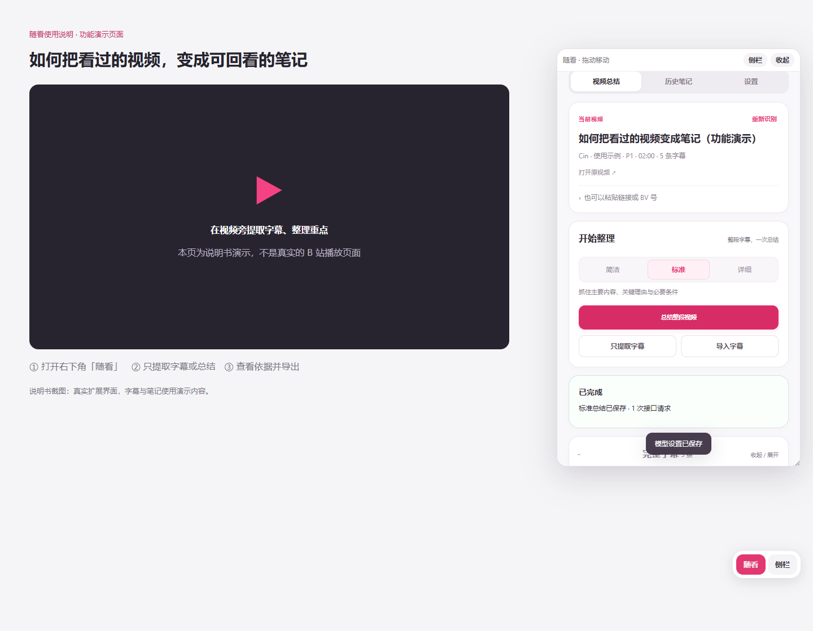

# 随看浏览器扩展 · 0.1.1

在桌面 Edge / Chrome 的 B 站视频页打开浮窗或侧栏，提取完整字幕、生成总结和保存本地笔记。作者 Cin。当前以开发者模式安装，尚未上架扩展商店。

## 安装与操作

1. 从 [v0.1.17 发布页](https://github.com/siacin/suikan/releases/tag/v0.1.17) 下载 `SuiKan-Browser-0.1.1.zip`，解压到固定文件夹。
2. 打开 `edge://extensions` 或 `chrome://extensions`，开启开发者模式，加载包含 `manifest.json` 的 `suikan-browser` 文件夹。直接从本仓库加载时，选择当前 `browser-extension` 文件夹。
3. 在相同浏览器登录 B 站，打开视频，刷新页面；点击右下角「随看」或工具栏扩展图标打开浮窗/侧栏。
4. 只要字幕：点「只提取字幕」，选择格式后复制或保存。总结：在「设置」填写自己的模型地址、模型 ID 和 API Key，保存并授权域名，再选择简洁/标准/详细。
5. 成功笔记在「历史笔记」查看，可核对字幕依据并导出 Markdown。



截图为真实扩展界面，使用说明文稿、模型响应与播放页面均为演示内容，不代表真实视频分析。

## 三种程度与来源

三个档位均一次提交完整字幕，不自动分批；网络中断最多完整重试一次。简洁约 300–600 字、标准约 800–1500 字、详细约 2500–4500 字，实际长度由内容和模型决定。字幕区全文展示、固定高度滚动，可收起；支持 TXT/SRT 导出和 TXT/SRT/VTT 导入。导入文稿不会冒充已核验视频。

识别的是当前标签页的视频与分 P。切换视频会停止旧任务、清理旧结果；无法确认字幕来源时停止。无音频转写或画面理解，字幕与模型仍可能有误。模型调用在面板文档中进行，关闭/刷新面板可能中断任务，收起浮窗会保留文档。

## 数据与统计

模型和字幕请求相互隔离。模型 API Key 默认仅存浏览器会话，可选择记住到扩展本地存储。笔记保存在本机，安卓与浏览器的数据独立。

本发行版默认接入作者腾讯云统计：安装、日期、版本及主动总结的已核验视频标题/BV/AV/CID/分 P、详细程度、时间与结果。服务端存随机安装号散列，视频记录保留 90 天。不上传字幕、笔记正文、模型密钥或 B 站 Cookie；仅提取、导入文稿、连接测试与查看历史不产生视频明细。详见 [PRIVACY.md](PRIVACY.md)。本版不是经过微软商店审核的提交版。

## 更新与开发

更新时覆盖原文件夹后重新加载，保留原路径；另建目录加载可能改变扩展编号，使原设置和笔记不可见。升级前可导出重要笔记。

```bash
npm install
npm test
npx playwright install chromium
node tests/browser-smoke.cjs .local/browser-smoke
python scripts/package.py
```

`npm test` 运行核心及真实本机 HTTP 测试。浏览器交互测试使用本地演示服务，自动将测试副本统计地址指向本机，不向正式云端上报；可设置 `SUIKAN_BROWSER_EXE` 测试已安装的 Edge / Chrome，或设置 `SUIKAN_PLAYWRIGHT` 使用现有 Playwright。

打包脚本输出安装 ZIP、源码 ZIP 与校验和到本目录上一级。程序运行不依赖 npm 包；Playwright 仅供开发测试。

[图文使用说明书](../README.md) · [验证范围](验证记录.md) · [问题反馈](https://github.com/siacin/suikan/issues)
